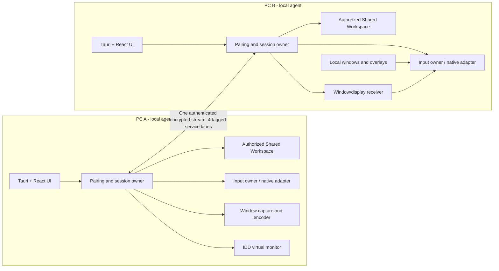

# CrossWarp architecture

**Architecture status:** target design is documented; several native/streaming services are still prototypes or contracts. Refer to [Feature status](FEATURE_STATUS.md) before assuming a diagrammed component is complete.

## Product model

CrossWarp is designed as one application instance per PC and one paired session that coordinates four independent services. An app process does not move to the other operating system. The intended cross-PC window experience is a live remote proxy controlled through authenticated input forwarding. The display service is different: it presents a true source-owned logical monitor created by a Windows indirect display driver (IDD).

The target diagram intentionally includes components that are not yet implemented. Current runtime: pairing/session activates the file RPC worker; input diagnostic uses the local Raw Input bridge without network forwarding; display/window lanes have no desktop capture/render producers/consumers.

## Implemented repository components

### Desktop application (`apps/desktop`)

- `src/ui/App.tsx` implements the overview screen, local folder chooser/browser, LAN discovery and pairing flow, trusted reconnect, peer workspace controls, transfer progress, capability states, and local-only input-capture diagnostic.
- Tauri `src-tauri/src/main.rs` owns UI commands, identity loading, listener/discovery lifecycle, pairing approval events, trusted reconnect, session state, file RPC calls, bounded file transfers, and native input diagnostic lifecycle.
- Tauri capabilities allow the default core APIs and folder-selection dialog. The webview Content Security Policy is set in `src-tauri/tauri.conf.json`.
- The installer target is NSIS x64. Current package is unsigned and does not install a driver.

### Rust agent (`crates/agent`)

| Module | Responsibility | Current boundary |
|---|---|---|
| `protocol.rs` | Device/session IDs, protocol version, four capability names/status states | Shared type contract |
| `trust.rs` | Ed25519 identities, transcript, six-digit code, two-sided approval proof | Unit-tested; used by pairing transport |
| `identity_store.rs` | DPAPI-protected per-user signing identity | Windows-only persistent store |
| `peer_store.rs` | Mutually approved peer public keys in a DPAPI-protected store | Trusted reconnect pins |
| `transport.rs` | Pair/reconnect handshake, ephemeral X25519, HKDF, ChaCha20-Poly1305 records | Authenticated async reliable stream |
| `lan.rs` | Ephemeral TCP listener and mDNS advertisement/browser | Discovery is untrusted hint; physical mDNS not yet accepted |
| `session.rs` | Four capability state coordinator | UI does not yet expose authoritative peer-wide live states |
| `session_transport.rs` | Four tagged, bounded service lanes and writer priority | All four lanes are created; only file lane is consumed in desktop |
| `shared_files.rs` | Capability-rooted filesystem operations and upload transaction | Host-side storage implementation |
| `file_rpc.rs` | Bidirectional request/response file operations over file lane | Desktop client/server worker is wired |
| `ownership.rs` | Hit testing, focus ownership, held-key/button source ownership | Contract only; not synchronized with desktop surfaces |
| `input_session.rs` | Ordered input envelopes, destination/transition checks, release model, ownership-aware session controller | Agent-level authenticated lane tests; native capture and receiver injection remain disconnected |
| `windows_input.rs` | Safe Rust wrapper for C ABI Raw Input/SendInput bridge | Local diagnostic plus tested native-to-session event conversion; not connected to ownership, transport, suppression or injection |
| `media_session.rs` | Binary window/display frame metadata and sequencing checks | No capture/encode/decode/render integration |
| `platform.rs` | Windows build/API-floor reporting | API floor is not support certification |

The root Cargo workspace contains the agent crate. The Tauri app has a separate Cargo manifest/workspace under `apps/desktop/src-tauri`.

### Native Windows pieces

- `native/windows-bridge/input-bridge` registers a message-only Raw Input sink and injects an event with `SendInput`. Raw Input does not suppress local input. The native contract test does not inject synthetic user input.
- `native/windows-bridge/capture-smoke` captures one visible HWND frame using Windows.Graphics.Capture and writes a BMP. It is a local spike, not a streaming component.
- `native/idd` and `spikes/phase0/microsoft-idd-sample` contain the official Microsoft IddSampleDriver spike/build notes. The sample is not the CrossWarp production driver; its package remains unsigned/unloaded.
- `browser` is documentation for a planned companion only. There is no extension/native messaging host implementation yet.

## Pairing and connection lifecycle

1. Each instance creates or loads a per-user device signing identity.
2. Each instance binds a TCP listener to an ephemeral port, advertises a device fingerprint/name/port using mDNS, and browses for peers.
3. The initiator connects to a discovered socket address. mDNS values are not authentication.
4. New pairing exchanges roles, public identity keys, fresh nonces, and ephemeral X25519 keys; both users must approve matching verification codes and signatures must verify.
5. A reconnect is accepted only if the presented public key/fingerprint matches the saved mutually-approved peer and fresh signatures prove possession.
6. A derived directional key pair protects framed traffic. One session-multiplexer reader and prioritized writer serve four queues.
7. File RPC starts for the session and exposes only the local user's selected Shared Workspace root.
8. Disconnect/transport failure aborts file/session workers and removes the active-peer state. Input release recovery is not yet wired into this lifecycle.

## Session lanes and scheduling

The transport prepends a service tag to encrypted payloads. Input is lossless/high-priority; window and display video are freshness-oriented and may drop frames; file operations are lossless and backpressured. Each service queue is bounded. The scheduler periodically serves lower-priority lanes so display and bulk files cannot be permanently starved by input/video traffic. This controls application queueing only: the shared reliable TCP stream can still suffer head-of-line blocking from packet loss, and no low-latency physical Wi-Fi result has been demonstrated.

## Shared Workspace data flow

The host opens the explicitly selected root as a capability directory. Remote paths are relative to that capability; the remote party never supplies a host-absolute filesystem path. List/read/metadata/directory/upload/rename/delete operations travel in JSON RPC messages, with bounded chunks. Uploads use temporary files and checksum validation; replacing a file is a separate explicit-confirmation operation. Downloads are written to a same-folder temporary path and committed only after metadata and digest validation.

## Not yet implemented data paths

- Input: native capture → determine local-vs-remote surface owner → suppress only remote-owned events using a valid Windows-supported path → encrypted input lane → explicit destination consent → receiver transition validation → `SendInput` → balanced release on disconnect. The current diagnostic only counts local event types.
- Window portal: enumerate/select/consent → per-window capture → low-latency codec/transport → proxy creation/render → resize/focus/close lifecycle → return pointer/keyboard/clipboard operations to origin process. A single local WGC frame test is not this path.
- Extended display: supported signed IDD creates a real logical monitor → source composition frames are captured/encoded → display lane → peer receiver decode/present → correct multi-monitor coordinates/ownership. The official sample build is not this path.
- Clipboard: ownership arbitration, format allow-list, user privacy settings, and bidirectional transfer are not implemented.

## Architecture principles

1. Keep one session and concurrent capabilities; a failing video service must not tear down files or input.
2. Choose native adapters by detected OS/API/driver capability, but do not call a capability supported until its acceptance tests pass.
3. Keep capture, encode/decode, display driver, file storage, and input policy out of the React UI; expose small typed commands/events.
4. Use bounded queues and prioritize control/fresh interactive frames over bulk throughput while still proving file progress.
5. Never use API names or compile success as a substitute for runtime proof. Detailed security/permission boundaries are in [Security and privacy](SECURITY_AND_PRIVACY.md).
